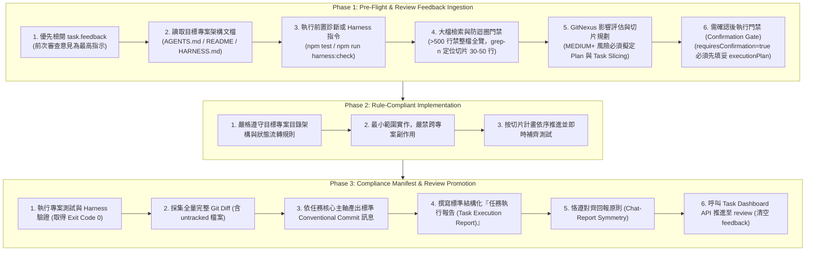

# Task Dashboard — 平台自動化執行與品質門禁標準 (Automation Standard & Execution Gate)

本標準定義 **Task Dashboard** 的雙軌自動化機制、任務生命週期流轉規範、3-Phase 執行門禁，以及任務執行報告格式標準。此規範屬於 **Task Dashboard 平台流程標準**，適用於所有由 Task Dashboard 管理與派工的專案。

---

## 1. 雙軌自動執行機制 (Dual Automation Engines)

Task Dashboard 支援 **Desktop AI 哨兵待命 (Reactive Wakeup)** 與 **獨立 CLI Agent 即時觸發** 兩種自動化驅動模式：

### 模式 A：Desktop AI 哨兵待命 (Reactive Wakeup 即時喚醒 / 或循環排程)
- **運作模式（即時零延遲，0 Token 開銷）**：
  由 Desktop AI（如 Google Antigravity、Claude Code、OpenAI Codex、Cursor 等）透過背景終端指令啟動哨兵腳本：
  ```bash
  node "$HOME/Library/Application Support/TaskDashboard/watch-task-gate.js"
  # 或指定專屬 Agent 認領：
  node "$HOME/Library/Application Support/TaskDashboard/watch-task-gate.js" --agent=antigravity
  ```
- **工作原理**：
  腳本利用 macOS 原生 FSEvents 在背景靜默監聽資料庫 `tasks.json`。一旦任務變更為 `in_progress` 或請求依據 Diff 生成 Commit 訊息 (`requestCommitGen: true`)，哨兵立即輸出完整開工上下文並以 `exit(0)` 正常退出，觸發外部 IDE 的 **Reactive Wakeup** 喚醒機制。
- **Agent 接續開工**：
  AI 被喚醒後，根據哨兵輸出的開工指示執行 **3-Phase Execution Gate**。若執行環境支援 Subagent 工具，應依據雙階自動調度策略委派執行與審核。執行完畢將任務推進至 `review` 後，主 Agent 再次在背景掛載哨兵，進入下一輪無縫待命。

### 模式 B：本機 CLI Agent 自動即時觸發
- 若使用者在 Dashboard 設定中啟用了 **「CLI Agent 模式」**（支援 `agy`、`claude`、`hermes` 或自訂指令）：
- 當任務被建立或拖曳切換至 `in_progress` 時，Task Dashboard Web Server 會**立即自動呼叫本機 CLI 指令**，動態組合目標專案路徑、需求、Harness 驗證指令與 3-Phase Gate 規範傳入。
- **自動交付管線 (Delivery Pipeline)**：
  CLI 執行結束後，Web Server 自動驗收：
  1. 完整採集工作區之已追蹤與未追蹤 Git Diff (`collectGitDiff`)。
  2. 依據 Diff 與 Conventional Commit 規範自動推導 Commit 訊息 (`formatCommitMessageFromSkill`)。
  3. 自動消耗並歸檔 Feedback 至 Description 歷史區塊 (`consumeTaskFeedback`)。
  4. 自動將 CLI 輸出整合成標準結構化任務執行報告 (`formatStructuredExecutionLog`)。
  5. 自動推進任務至 `review` 階段。

---

## 2. 嚴格 3-Phase Execution Gate (執行 SOP)

不論是由 Desktop AI 還是 CLI Agent 驅動，任務執行均須恪遵三階段品質門禁：



### Subagent 雙階自動調度策略 (Flash 執行 + Pro 審核)
當執行環境具備 Subagent 工具（如 `invoke_subagent`）時，為避免龐大程式碼檢索與終端輸出佔滿主視窗 Context，並落實客觀嚴格的代碼審查，平台制定**雙階自動調度策略**：

- **觸發條件**：
  當執行環境支援 Subagent 工具（如 `invoke_subagent`）且任務屬於正式實作、除錯或跨檔調查（**非**單純 `requestCommitGen: true` 亦**非**未填妥 `executionPlan` 之待確認狀態）時，主 Agent 應自動啟用 Subagent 執行。
- **雙模型分工（Flash 執行 → Pro 審核）**：
  1. **執行階段 (`Model: "flash"`)**：主 Agent 委派 `self` subagent（設定 `Model: "flash"`, `Workspace: "inherit"`）於獨立 Context 執行 Phase 1~2 程式碼實作、大檔切片檢索與單元測試。
  2. **審核階段 (`Model: "pro"`)**：實作完成後，主 Agent 委派 `self` subagent（設定 `Model: "pro"`, `Workspace: "inherit"`）進行 Phase 3 嚴格審核（檢驗 Git Diff 完整性、無截斷、無副作用、測試與 Harness 通過、結構化任務執行報告合規），審核通過後方推進至 `review`。
- **三大安全守則**：
  1. **強制繼承工作區 (`Workspace: "inherit"`)**：Subagent 必須設定 `Workspace: "inherit"`，確保所有 Git Diff 與檔案異動直接落於原專案工作區，嚴禁隔離導致 Diff 脫鉤。
  2. **完整任務上下文注入**：委派時必須注入完整任務上下文（包含 `taskId`, `projPath`, `description`, `feedback`, `harnessCmd`, 以及 API 交付格式）。
  3. **防搶單時序 (Race Condition Prevention)**：主 Agent 在 `flash` 執行與 `pro` 審核皆完成並將任務正式推入 `review` 後，才可重新掛載 `watch-task-gate.js` 進入背景待命。**嚴禁於 Subagent 運行期間提前重啟哨兵**，避免重複認領與衝突。

### Phase 1: Pre-Flight & Review Feedback Ingestion (審查回饋與前置檢閱)
1. **最高優先級門禁（Review Feedback 檢查）**：
   - 讀取任務物件中的 `task.feedback`。
   - **若 `feedback` 包含內容**：代表使用者對前次審查提出的最高修正指示（如具體修改、重構、暫存 `git stash`、切換狀態等）。AI **必須優先將 Feedback 作為本次開工的絕對目標**，嚴禁在未滿足 Feedback 要求前直接判定為完成並推回 `review`。
2. **閱讀目標專案架構規範文檔**：
   - 檢閱專案內的 `AGENTS.md`、`CLAUDE.md`、`README.md`、`HARNESS.md`。
3. **執行前置診斷或 Harness 指令**：
   - 執行專案的診斷指令（如 `npm run harness:check` 或單元測試），確認基底狀態健康。
4. **大檔掃描與 Token 節約鐵律 (Targeted Inspection & Anti-Loop Gate)**：
   - **禁止大檔整檔盲讀**：目標檔案若超過 500 行，嚴禁無上限全覽。一律先以 `grep -n` 定位關鍵函式、變數或行號，再以切片閱讀前後 30-50 行。
   - **單點檢索上限 (Max 2 Inspections)**：同一檔案相同區塊最多檢索 2 次；確定關鍵邏輯後立即進入修改與驗證，嚴禁原地循環重複呼叫。
   - **Fast-Track 輕量分流**：單一變數/邏輯修正優先進行精準微調與單元測試，避免發散式跨組件多輪思維。
5. **GitNexus 風險評估與切片規劃門禁 (GitNexus Risk Assessment & Slicing Gate)**：
   - 若專案具備 GitNexus 索引：異動關鍵函式/模組前，**必須使用 GitNexus 進行影響分析 (`impact`) 評估風險**。
   - 若風險等級為 **MEDIUM（中級）、HIGH（高級）、CRITICAL（極高）** 或 `UNKNOWN`：
     - **必須建立 Plan（實作計畫 / Implementation Plan）**，嚴禁直接盲目異動。
     - **必須切片處理（Task Slicing）**：將大範圍變更拆解為清晰、獨立、可個別驗證的子切片（Slices），依序分步推進。
6. **需確認後執行門禁 (Execution Plan Confirmation Gate)**：
   - 若任務標記為 `requiresConfirmation: true` 且尚未提供 `executionPlan`（或為空）：
     - 開工首要任務為**擬定完整執行計劃**（包含執行步驟、架構評估、驗證方式）。
     - 將執行計劃寫入 `task.executionPlan`。
     - **嚴禁在未填寫執行計劃前跳過規劃**；任務在計劃填妥後方會正式進入「待確認」狀態，並供使用者點擊「確認並執行」。使用者確認點選後，方可進入 Phase 2 代碼實作。

### Phase 2: Rule-Compliant Implementation (合規實作)
1. 嚴格遵守該專案的目錄架構、狀態流轉規則與切片計畫。
2. 僅在該專案的範疇內修改程式碼，不得跨專案產生不相關的副作用。
3. 若存在切片計畫，按切片逐步進行最小範圍實作與即時驗證。

### Phase 3: Compliance Manifest & Review Promotion (合規驗證與交付)
1. 執行該專案的測試與驗證指令（如 `npm test`、`npm run build:app`），取得 Exit Code 0。
2. **全量完整 Git Diff 採集**：
   - 記錄實際修改檔案清單 `modifiedFiles`。
   - 記錄產生的 `diff`：必須包含已追蹤 (`git diff HEAD`) 與未追蹤 (`git diff --no-index /dev/null <untracked>`) 檔案之全量完整無截斷 diff。
3. **依據任務核心主軸產出標準 Commit 訊息 (`commitMessage`)**：
   - 結構化 Commit 格式：`task.commitMessage = { "subject": "<type>(<scope>): <clean_subject>", "body": "- <重點 1>\n- <重點 2>" }`。
   - **【核心主軸原則】**：即使任務歷經多次 Feedback 修訂，Commit 主旨 (subject) 必須嚴格鎖定任務原始核心主軸，內文 (body) 則綜合全量實際異動項目與歷次 Feedback 修訂重點，嚴禁將主旨退化為最後單一一次 Feedback 的局部微調。
4. **撰寫標準結構化『任務執行報告 (Task Execution Report)』**：
   - 格式必須包含以下四大核心章節與折疊原生輸出：
     ```markdown
     # 📋 任務執行報告 (Task Execution Report)

     ## 1. 任務目標與根因分析 (Objective & Root Cause)
     - **核心目標**：...
     - **問題根因 / 挑戰**：...

     ## 2. 解決方案與核心異動 (Resolution & Key Changes)
     - **處理邏輯**：...
     - **檔案異動明細**：
       - `path/to/file`: 核心邏輯異動說明

     ## 3. 歷次審查因應 (Feedback Addressed)  <!-- 若有 feedback 則列出 -->
     - 具體針對使用者前次回饋之處置說明

     ## 4. 品質驗證與交付證明 (Verification & Test Evidence)
     - **執行指令**：`npm test`
     - **退出碼 (Exit Code)**：`0` (驗證通過 ✅)
     - **測試指標**：通過測試案例數量與覆蓋率說明

     <details>
     <summary>點擊展開原生終端與 Harness 輸出記錄 (Raw Terminal Output)</summary>

     ```text
     [原生終端指令輸出，保留可用輸出且不得截斷，敏感憑證嚴禁寫入]
     ```
     </details>
     ```
5. **對齊回報原則 (Chat-Report Symmetry)**：
   - AI 在 chat 視窗回報給使用者的「實作變更」與「測試驗證」核心內容，**必須 100% 同步寫入 `task.executionLog` 的核心章節**。
   - 嚴禁在 chat 中輸出詳盡分析但在 `executionLog` 只寫單行狀態戳記。若日誌未包含具體邏輯更動與測試指令結果，視為品質門禁未通過。
6. **推進狀態至 Review**：
   - 將 feedback 內容附加寫入 `task.description` 尾端（保留原始需求，以 `\n\n--- 【歷次審查意見 / Feedback 記錄】 ---\n[Timestamp]\n- <feedback>` 區隔），並清空 `task.feedback`。
   - 將任務狀態更新為 `status: "review"`，重置 `requestCommitGen: false`。

---

## 3. 平台 API 交付與狀態流轉規範 (API-First Delivery)

為避免 Agent 在受管專案中透過原生腳本硬編碼讀寫底層資料庫，Task Dashboard 提供標準 REST API 進行任務生命週期管理：

### 推薦：透過 REST API 推進 Review
當 Agent 完成 Phase 1~3 實作與驗證後，直接呼叫本機 Task Dashboard API：
```bash
curl -X PUT "http://localhost:3030/api/tasks/<task_id>" \
  -H "Content-Type: application/json" \
  -d '{
    "status": "review",
    "executionLog": "<結構化任務執行報告內容>"
  }'
```
> [!NOTE]
> 當透過 API 推進至 `review` 時，Task Dashboard 後端會**自動觸發交付管線**：
> 1. 自動採集該專案的工作區全量 Git Diff。
> 2. 自動產出符合 Conventional Commit 規範的結構化 Commit 訊息。
> 3. 自動消耗並將 Feedback 歸檔至 Description 歷史中。
> 4. 自動格式化日誌並提取測試覆蓋率報告。

### 備用：離線或無 HTTP 連線時之 Node.js 回寫
若本機 Web Server 暫時未啟動，可直接回寫唯一真實資料庫（`~/Library/Application Support/TaskDashboard/tasks.json`）：
```bash
node -e '
const fs = require("fs"); const path = require("path"); const os = require("os");
const dbPath = path.join(os.homedir(), "Library/Application Support/TaskDashboard/tasks.json");
const tasks = JSON.parse(fs.readFileSync(dbPath, "utf8"));
const task = tasks.find(t => t.id === "<task_id>");
if (task) {
  task.status = "review";
  task.requestCommitGen = false;
  // 附加 feedback 至 description 並清空 feedback
  if (task.feedback) {
    const timeStr = new Date().toISOString().replace("T", " ").slice(0, 19);
    task.description = (task.description || "") + "\n\n--- 【歷次審查意見 / Feedback 記錄】 ---\n[" + timeStr + "]\n- " + task.feedback;
    task.feedback = "";
  }
  fs.writeFileSync(dbPath, JSON.stringify(tasks, null, 2));
}
'
```

---

## 4. Single Source of Truth 與資料隔離原則

- **唯一真實資料庫**：
  `~/Library/Application Support/TaskDashboard/tasks.json`（或透過 REST API `http://localhost:3030/api/tasks`）。
- **範本資料夾隔離**：
  `task-dashboard` 倉庫內的 `data/` 目錄僅作為全新檢出時的初始結構範本，**執行時嚴禁覆寫專案內的 `data/tasks.json`**。
- **Diff 產物隔離**：
  任務切換至 `in_progress` 時，後端自動重置前次殘留之 `diff`、`modifiedFiles` 與 `commitMessage`，避免跨任務或重試時產物殘留造成誤判。
