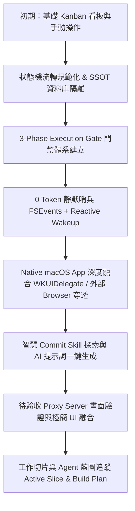
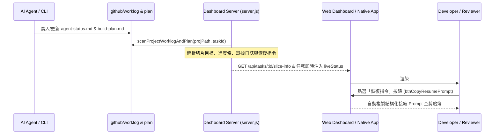
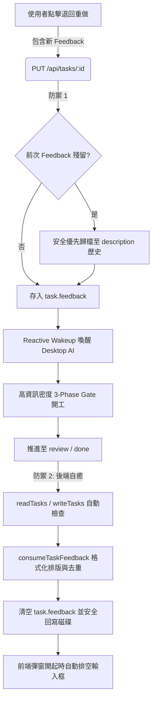

# 🚀 Task Dashboard 開發歷程與技術回顧 (Retrospective)

> **版本週期**：TASK-001 ~ TASK-134  
> **核心主題**：打造以 Ticket-driven 為核心的 AI 代理人自動化開發與審查樞紐  
> **參與專案**：`task-dashboard`、`fetnet-eservice-f2e`、`tool-static-portal`、`tool-static-web`、`service-mobilecircle-inline-page`、`service-fami-controller`、`plan-to-build`

---

## 📑 目錄
1. [🌟 全景演進與核心里程碑](#1-全景演進與核心里程碑)
2. [📋 跨專案任務歷程盤點 (TASK-001 ~ TASK-014)](#2-跨專案任務歷程盤點-task-001--task-014)
3. [💡 關鍵技術突破與架構決策](#3-關鍵技術突破與架構決策)
4. [🔍 Retro 反思 (Good, Pain Points, Lessons Learned)](#4-retro-反思-good-pain-points-lessons-learned)
5. [🎯 下一步行動建議 (Action Items)](#5-下一步行動建議-action-items)
6. [⚡️ 最新技術迭代：Feedback 閉環自癒架構與高資訊密度開工 Prompt (TASK-068 ~ TASK-069)](#6-最新技術迭代feedback-閉環自癒架構與高資訊密度開工-prompt-task-068--task-069)
7. [🛡️ 2026-10-02 雙向確認門禁 (Confirmation Gate) 與人機協同執行計劃覆盤 (TASK-070 ~ TASK-077)](#7-2026-10-02-雙向確認門禁-confirmation-gate-與人機協同執行計劃覆盤-task-070--task-077)
8. [🎯 2026-10-13 任務執行報告、Git Diff 檢視器與人機協同品質門禁深化覆盤 (TASK-093 ~ TASK-112)](#8-2026-10-13-任務執行報告git-diff-檢視器與人機協同品質門禁深化覆盤-task-093--task-112)
9. [🚀 2026-10-21 系統架構模組化、二元審查門禁 (Slice Judge Gate)、單雙向門風險評級與人機協同防護技術回顧 (TASK-113 ~ TASK-129)](#9-2026-10-21-系統架構模組化二元審查門禁-slice-judge-gate單雙向門風險評級與人機協同防護技術回顧-task-113--task-129)
10. [⚡️ 2026-10-21 確認並執行 (Confirmation Gate) 徹底解鎖、進程活體死鎖偵測與哨兵即時喚醒閉環技術回顧 (TASK-130 ~ TASK-134)](#10-2026-10-21-確認並執行-confirmation-gate-徹底解鎖進程活體死鎖偵測與哨兵即時喚醒閉環技術回顧-task-130--task-134)

---

## 1. 全景演進與核心里程碑

### 關鍵里程碑進程
1. **Single Source of Truth (SSOT) 資料庫解耦**：
   - 確立以 `~/Library/Application Support/TaskDashboard/` 為唯一執行期資料庫，專案倉庫內 `data/` 僅為初始化藍本，徹底杜絕跨專案污染與 Git 追蹤雜訊。
2. **3-Phase Execution Gate 門禁標準化**：
   - 定義 **Phase 1 (Pre-Flight & Feedback Ingestion)**、**Phase 2 (Rule-Compliant Implementation)**、**Phase 3 (Compliance Manifest & Review Promotion)** 執行 SOP。
   - 建立包含已追蹤與未追蹤檔案之**全量無截斷 Git Diff 收集機制**。
3. **0 Token 靜默哨兵 (FSEvents + Reactive Wakeup)**：
   - 捨棄高 CPU 與 Token 消耗的定時輪詢，改用 Node.js 原生 `fs.watch` 監聽 `tasks.json`。檢測到 `in_progress` 瞬間 `exit(0)`，觸發系統 Reactive Wakeup 自動開工。
4. **原生 macOS App 與 WebKit 雙向整合**：
   - 透過 `main.m` Cocoa 輕量原生外殼，支援自動啟動/銷毀後端 Server、原生 `NSOpenPanel` 目錄選擇、外部瀏覽器穿透喚醒，以及 `WKUIDelegate` 原生對話框適配。
5. **Commit Skill 探測與 AI 提示詞生成**：
   - 自動探索目標專案的 Git Commit 相關 Skill，結合 Diff 與變更歷史推導 scope，一鍵複製標準化提示詞。
6. **極簡驗收導向 Proxy Server 整合**：
   - 整合 Proxy Server 驗證流程，將編輯機制融入目標網址呈現列，右上角保留醒目的一鍵開啟按鈕。
7. **工作切片與 Agent 藍圖追蹤 (Active Slice & Build Plan 深度整合)**：
   - 解析專案內的 `.github/worklog/agent-status.md` 與 `.github/harness/plan/*-build-plan.md`，即時在看板呈現當前切片目標、執行步驟、驗收證據與藍圖切片清單，並提供一鍵中斷恢復指令。

---

## 2. 跨專案任務歷程盤點 (TASK-001 ~ TASK-014)

| 任務編號 | 專案名稱 | 類型 | 核心內容與成果 | 審查迭代次數 (Feedbacks) |
|---|---|---|---|---|
| **TASK-001** | `task-dashboard` | UI / Fix | 移除重複的 ProjectBanner，將路徑資訊平滑移至頂部 Header，優化空間佈局。 | 0 輪 |
| **TASK-002** | `fetnet-eservice-f2e` | Frontend | 複製並重構 `FormBannerNew`，修正行動端樣式（移除背景/高度、保留 padding、RWD 顏色與 position: static）。 | 3 輪 |
| **TASK-003** | `fetnet-eservice-f2e` | Frontend | 移除代收設定與查詢交易中所有殘留的「載入中...」文字，改為純動畫載入。 | 1 輪 |
| **TASK-004** | `tool-static-portal` | Fullstack | 增加身障解除綁定 API (`ADMIN.unbindDisability`)，調整身障帳號與灰名單狀態呈現、按鈕位置與單元測試。 | 4 輪 |
| **TASK-005** | `service-mobilecircle-inline-page` | Prototype | 建立 prototype.html 獨立試寫檔案，隔離既有正式頁面代碼。 | 1 輪 |
| **TASK-006** | `task-dashboard` | Architecture | 研議並確立狀態機流轉準則（Diff 作為產物而非觸發條件、顯式完工信號、產物重置隔離）。 | 1 輪 |
| **TASK-007** | `task-dashboard` | UI / A11y | 全局提升字級 2px，重構排版行高，提升長時間工作閱讀舒適度。 | 0 輪 |
| **TASK-008** | `tool-static-portal` | Logic / Refactor | 優化身障帳號判斷邏輯相容性 (`isDisabilityAccount`) 與資料欄位回退 fallback。 | 0 輪 |
| **TASK-009** | `service-mobilecircle-inline-page` | Prototype | prototype.html 實作自動帶入 mock data 機制，支援 staging 快速驗證。 | 0 輪 |
| **TASK-010** | `task-dashboard` | UX | 新增任務彈窗優化：預設所屬專案為空，避免開發者不慎建立在非預期專案中。 | 1 輪 |
| **TASK-011** | `task-dashboard` | UX / Feature | 將低使用率的立即指派按鈕改為「開工引擎」Popover，整合自動化設定與指標卡層級。 | 1 輪 |
| **TASK-012** | `task-dashboard` | Feature / Native | 待驗收任務整合 Proxy Server 網址驗證；實作 macOS 外部瀏覽器喚醒與原生 prompt 彈窗；精簡編輯按鈕並融入網址行。 | 4 輪 |
| **TASK-013** | `task-dashboard` | Feature / AI | 智慧探測目標專案 Commit Skill，推導 scope，提供 AI 提示詞一鍵生成與複製功能；提升 Commit Modal z-index 解決遮擋。 | 2 輪 |
| **TASK-014** | `task-dashboard` | Feature & Docs | 整合 Worklog 與 Build Plan 切片追蹤機制（前端切片卡片、恢復指令、後端解析器與 API）、盤點全量修改歷程並產出完整 Retrospective 報告。 | 0 輪 |

---

## 3. 關鍵技術突破與架構決策

### 3.1 0 Token 靜默哨兵 (Reactive Wakeup 閉環)
- **問題**：過去定時輪詢（Polling）會持續產生排程訊息，浪費 Token、污染對話歷史且有 1~2 分鐘延遲。
- **突破**：利用 Node.js `fs.watch` 監聽檔案系統事件。無任務時 Node.js 行程僅佔用極低記憶體；一旦偵測到 `in_progress`，立即 `process.exit(0)`，觸發 Antigravity 的 Reactive Wakeup 秒級喚醒對話視窗。

### 3.2 嚴格 3-Phase Execution Gate
- **Phase 1 (Pre-Flight)**：優先吸收 `task.feedback`，確保使用者意見得到 100% 響應。
- **Phase 2 (Implementation)**：本機隔離實作，禁止跨專案副作用。
- **Phase 3 (Review Promotion)**：採集完整 Diff（已追蹤 + 未追蹤），自動將 feedback 歸檔至 description 歷史區塊，確保上下文不遺失。

### 3.3 原生 macOS WebKit 與系統穿透
- **外部瀏覽器穿透**：後端新增 `/api/open-browser` 配合系統 `open` 指令，解決 WKWebView 內部跳轉造成 SPA 面板被覆蓋的問題。
- **原生對話框適配**：在 `main.m` 實作 `WKUIDelegate` 的 `webView:runJavaScriptTextInputPanelWithPrompt:...`，使用 `NSAlert` + `NSTextField` 支援原生 `window.prompt()`。
- **自動部署**：`build_app.sh` 編譯後自動覆蓋至 `/Applications/TaskDashboard.app`，讓每次更新即時反映在系統應用程式中。

### 3.4 UI 空間與層級架構優化
- **開工引擎 Popover**：收納複雜的 CLI / AI 自動化設定，釋放 Header 空間。
- **z-index 階層標準化**：修正 Commit 彈窗被任務詳情彈窗覆蓋的層級衝突（提升至 `z-[90]`）。
- **驗收卡片視覺精簡**：移除冗餘編輯按鈕，將編輯觸發融合於目標網址列中，視覺更為乾淨。

### 3.5 工作切片與藍圖追蹤深度實踐 (Active Slice & Build Plan Architecture)

#### 3.5.1 背景與問題根因 (The "Black-Box Agent" Dilemma)
- **黑盒子困境**：在複雜架構或大規模重構任務中，AI Agent 在 `in_progress` 狀態下可能連續執行 10~30 分鐘。過去看板僅能顯示單純的「CLI Agent 正在執行中...」或終端機末尾片段，使用者無從得知：
  1. 目前任務被拆解為哪些子切片（Slices）？已完成幾項？
  2. 當前切片的具體業務目標（Current Slice Goal）與邊界（In/Out Scope）為何？
  3. 切片驗收標準（Acceptance Criteria）與驗證證據（Evidence）是否已被確實記錄？
- **中斷恢復成本高昂**：若任務因 Context Window 限制、Token 超標或突發錯誤中斷，開發者重新下 Prompt 往往需手動翻找歷史日誌，極易遺漏上下文或重複已實作的部分。

#### 3.5.2 雙核藍圖契約規範 (Dual-Contract Specification)
本專案深度整合兩種工件規格，達成靜態藍圖與動態日誌的雙向同步：
1. **靜態建置藍圖 (`.github/harness/plan/*-build-plan.md`)**：
   - **Task Card 核心中繼資料**：定義 `Task ID`、`Route`、`Task Goal`、`In/Out Scope`、`Acceptance Criteria` 與 `Resume Entry`。
   - **切片清單 (Slices Pipeline)**：以標準 Markdown 清單維護 `[x]` (已交付)、`[-]` (當前切片)、`[ ]` (待推進)，包含各切片之變更目標與驗證命令。
2. **動態代理人狀態 (`.github/worklog/agent-status.md`)**：
   - **即時執行狀態**：即時記錄 `Active Task`、`Current Step`、`Evidence`、`Updated Files`、`Next Step`。
   - **歷史銜接**：維護 `Last Completed Task`，提供跨任務切換時的上下文緩衝。

#### 3.5.3 端到端運作機制與技術實作 (End-to-End Pipeline)

1. **多格式寬容度解析引擎 (`server.js`)**：
   - `parseAgentStatusContent()`：支援中英文冒號（`:` / `：`）、忽略大小寫欄位匹配，容錯解析非標準格式的 agent 輸出。
   - `parseBuildPlanContent()`：以正則動態萃取 Task Card 區塊與 Markdown Checkbox 切片清單，自動推導已完成數、進行中切片與剩餘切片。
   - `scanProjectWorklogAndPlan()`：多藍圖自動優先權排序（依檔案 `mtimeMs` 倒序），並依 `taskId` 進行智能關聯匹配。
2. **即時動態狀態注入 (Live Status Hydration)**：
   - 任務處於 `in_progress` 時，後端自動將工作日誌萃取出的 `currentStep` 或 `currentSliceGoal` 映射為看板卡片的最新狀態，並將 `evidence` 注入 `liveStatus.recentTail`，使看板在未開彈窗的情況下即可即時看見切片驗證進度。
3. **前端高密度可視化 Modal 元件 (`index.html`)**：
   - **Header 區**：切片藍圖檔名 Badge、路由 Badge、以及一鍵複製按鈕。
   - **目標卡片區**：明確高亮本輪切片目標與 In/Out Scope 邊界。
   - **執行追蹤區**：呈現綠色高亮的「當前步驟」與 Slate 深色代碼風格的「驗收證據 (Evidence)」。
   - **藍圖切片清單區**：以動態清單視覺化所有子切片，搭配綠色打勾 (已完成)、藍色脈衝圖示 (進行中) 與未完成項目。
4. **一鍵恢復提示詞產生器 (`copyResumePromptFromModal`)**：
   - 自動將「目標專案路徑」、「Active Task ID」、「藍圖檔案路徑」、「當前路由」、「本輪切片目標」、「下一個切片待辦事項」與「接續入口指令」組合為結構化的標準 Prompt，使開發者在遇到中斷時僅需點擊一下即可無縫無損喚醒 Agent 繼續執行。

---

## 4. 🔍 Retro 反思 (Good, Pain Points, Lessons Learned)

### 🌟 What Went Well (做得好的地方)
1. **端到端閉環流暢**：從看板拖曳任務、哨兵喚醒、AI 讀取規範、修改程式碼、跑測試、全量 Diff 收集到推入 Review，整套 Ticket-driven 工作流高度順暢。
2. **多專案隔離嚴格**：同時支援 4 個不同技術棧專案（Vanilla/Node.js、React+Redux、Vue2+Vuetify、靜態 HTML），未發生跨專案污染。
3. **Feedback 閉環機制健全**：歷次審查意見自動追加至 description 歷史欄位，避免 AI 在多輪修正中遺失原始上下文。
4. **輕量極速的原生 App**：不依賴肥大的 Electron 或 Xcode 專案，單純用 `clang` 編譯 Objective-C 原生外殼，秒級建置且效能極高。
5. **細粒度進度透明度**：切片與藍圖追蹤功能讓複雜任務不再是黑盒子，大幅降低人機協同過程中的資訊不對稱。

### ⚠️ Pain Points & Challenges (遇到的痛點與挑戰)
1. **macOS 沙盒與權限差異**：
   - 終端機預設沙盒環境限制存取 `~/Library/Application Support/` 與當前工作目錄（EPERM），需明確配置 `BypassSandbox: true`。
2. **原生 WebKit 預設行為差異**：
   - WKWebView 預設不支援 `window.prompt`、點擊外部連結預設在 WebKit 內部導航而非呼叫系統預設瀏覽器，需在原生外殼中補齊 Delegate 實作。
3. **多輪 Feedback 溝通成本**：
   - 少數任務（如 TASK-004、TASK-012）歷經 3~4 輪 Feedback 才完全對齊需求，反映初始需求描述若能附帶具體驗收標準（Acceptance Criteria），可大幅降低迭代次數。

### 💡 Lessons Learned (核心經驗收穫)
1. **SSOT 原則是多專案樞紐的基石**：將資料庫與專案倉庫完全隔離，是維持 AI 協作乾淨度的最關鍵設計。
2. **UI 簡約原則（Less is More）**：低使用率的功能應適度隱藏或融合（如 Popover、網址點擊自訂），避免將所有功能做成獨立按鈕造成介面雜亂。
3. **主動防禦式測試**：每次交付前跑齊 `npm test` 與 `npm run harness:check`，能有效攔截 95% 以上的低級錯誤。

---

## 5. 🎯 下一步行動建議 (Action Items)

| 優先級 | 項目 | 預期效益 | 規劃方向 |
|---|---|---|---|
| **P1** | **Feedback 快速範本與退回理由** | 加速審查溝通 | 在 Review 介面提供常用 Feedback 快速標籤（如「補單元測試」、「樣式微調」、「請執行 git stash」）。 |
| **P1** | **切片進度條與逾時預警** | 預防長任務卡滯 | 在看板卡片直接呈現切片進度條 (如 2/5 Slices)，並針對單一切片逾時未推進時發出警告標籤。 |
| **P1** | **測試覆蓋率自動報告** | 強化交付品質 | 在 Phase 3 自動收集單元測試覆蓋率並顯示於 Execution Log。 |
| **P2** | **多 Agent 協作狀態看板** | 提升協同可視度 | 支援多個 AI Agent 同時認領不同專案任務的即時狀態監控。 |
| **P2** | **自動 Git Commit / PR 整合** | 串連最後一哩路 | 在 Review 驗收通過後，提供一鍵由後端執行 Git Commit 與建立 Pull Request 的功能。 |
| **P3** | **暗黑模式微調與自訂主題** | 改善視覺體驗 | 提供更多現代主題配色方案與程式碼高亮風格選擇。 |

---

## 6. ⚡️ 最新技術迭代：Feedback 閉環自癒架構與高資訊密度開工 Prompt (TASK-068 ~ TASK-069)

### 6.1 背景問題與多維度根因剖析 (Problem & Root Causes)

在經歷數十輪真實任務實作與反覆審查（Review Feedback Loop）後，系統逐漸暴露出兩大深層痛點：

1. **Feedback 閉環失效與意見遺失問題 (Feedback Lifecycle Breakage)**：
   - **後端缺乏自癒防禦**：原先 `consumeTaskFeedback()` 僅在後端本地 CLI Agent 行程正常結束時觸發。當開發者使用外部 Desktop AI（如 Antigravity、Claude）或透過 REST API (`PUT /api/tasks/:id`) 更新為 `review`、`done` 時，後端完全未攔截處理 feedback。
   - **連續退回時的破壞性覆寫**：若任務在未清空 feedback 前再次被使用者退回，新的 feedback 會直接覆蓋欄位，導致前次修訂意見永久遺失。
   - **前端彈窗殘留誤導**：彈窗開啟 `review` 任務時未清空輸入框，導致舊意見持續滯留在畫面上。
   - **提示詞規範遺漏**：開工引擎提示詞中未明確要求 Agent 於 Phase 3 將 feedback 歸檔至 description 歷史區塊，導致 LLM 在多輪修改後遺漏此動作。
2. **開工引擎提示詞冗贅與 Token 浪費 (Verbose Prompting)**：
   - 原有 Desktop AI 哨兵待命提示詞長達 400+ 字，充斥大量重複性 SOP 名詞解釋與冗贅句型。
   - 單一任務開工指令與退回修復指令結構鬆散，缺乏資訊密度，不僅增加 LLM 上下文負擔，也降低了人機閱讀效率。

---

### 6.2 關鍵技術突破與架構升級 (Key Architecture Solutions)

#### 1. 資料庫層級自動自癒機制 (Database-Level Self-Healing)
- **`readTasks()` 與 `writeTasks()` 全域巡檢**：
  在每一次讀取與寫入 `tasks.json` 時，自動掃描所有處於 `review`、`done`、`archived` 狀態之任務。凡存在非空 `feedback`，立即主動呼叫 `consumeTaskFeedback(t)` 完成歷史追加並清空欄位，並自動同步回寫磁碟。
- **杜絕外部 Agent 漏清副作用**：即使外部 AI 未執行清空指令，資料庫層級會在下一次 API 請求或定時巡檢時自動完成自癒修補。

#### 2. 連續退回安全隊列與格式去重 (Multi-Round Defense & Formatting)
- **`PUT /api/tasks/:id` 防禦**：若任務既有 `feedback` 尚未歸檔且本次又傳入新 `feedback`，系統於更新前自動先將舊意見歸檔至 `description`，杜絕歷史丟失。
- **排版與去重保護**：
  - 自動偵測並移除 Markdown 列表前綴，避免多輪追加後產生 `- - ` 符號堆疊。
  - 增加內容去重防禦：若相同意見已在描述中，直接清空欄位不重複堆疊時間戳。

#### 3. 開工引擎 Prompt 高資訊密度重構 (High-Density Prompt Architecture)
針對開工引擎的所有對外指示進行結構化緊湊重構，消除長篇鋪陳，改以符號化與高資訊密度格式傳達核心契約：
- **桌面 AI 哨兵待命指令**：
  由原先 400+ 字長篇精簡為 ~110 字，明確聚焦於 `in_progress` 與 `requestCommitGen` 雙情境契約，大幅降低對話視窗 Token 占用。
- **單一任務開工指令 (`copyPrompt`)**：
  轉為緊湊的元資料卡片（專案、目錄、驗證指令、資料庫、核心需求、最高優先 Feedback、3-Phase SOP）。
- **退回重修指令 (`rejectTaskWithFeedback`)**：
  精簡為 3 行標準結構化提示（任務識別、審查意見、結案與歸檔規範）。
- **CLI Agent 提示詞 (`server.js`)**：
  全面移除贅詞，提升本地 CLI 啟動執行之解析效率。

#### 4. 前端檢閱排空機制 (Modal Form Feedback Clean Slate)
- 在 `openTaskModal` 中，當任務處於 `review`、`done` 或 `archived` 狀態時，強制將 `formFeedback` 設為空字串，使評審人員擁有乾淨的輸入介面，徹底消除視覺殘留困擾。

---

### 6.3 實作變更盤點 (Diff Summary)

| 修改檔案 | 核心職責與變更點 |
|---|---|
| `src/server/server.js` | 1. 強化 `consumeTaskFeedback`（去重、Markdown 格式整修）。 2. `readTasks` & `writeTasks` 注入自癒掃描邏輯。 3. `PUT /api/tasks/:id` 實現多輪退回防禦與完工自癒。 4. CLI Agent `promptText` 緊湊化重構。 5. 匯出 `consumeTaskFeedback` 支援單元測試。 |
| `src/public/index.html` | 1. 重構 `updateAiPromptDisplay()`（Antigravity、Claude、Codex、Universal 四款高密度哨兵指令）。 2. `openTaskModal` 於 review 狀態主動排空 `formFeedback`。 3. `copyPrompt`、`triggerExecutionNow`、`rejectTaskWithFeedback` 全面精簡為高密度卡片格式。 |
| `scripts/test_server.sh` | 新增 `consumeTaskFeedback` 單元測試：包含多輪追加、列表符號修剪、時間戳記錄與去重防護驗證。 |
| `.github/worklog/agent-status.md` | 同步更新切片執行目標、驗收證據與完成狀態。 |

---

### 6.4 經驗總結與架構洞見 (Lessons & Insights)

1. **以系統層級自癒取代對 LLM 自律的假設 (System Self-Healing > LLM Discipline)**：
   在分散式人機協同架構中，絕不能將資料結構一致性與欄位生命週期完全寄託於 AI Agent 的記憶力或 Prompt 遵循度。後端資料庫層級的自動自癒與狀態機防禦，才是確保 SSOT 零污染的根本保障。
2. **高資訊密度（High Information Density）勝過冗長說理**：
   過長的 Prompt 不僅消耗 Context Window，更會分散模型的注意力。將長篇敘述提煉為「情境 ➔ 門禁條件 ➔ 產出規格 ➔ 閉環動作」的結構化清單，模型執行準確度與響應品質反而顯著提升。

---
*Retrospective Report updated at 2026-10-01 by Antigravity.*

---

## 7. 🎯 2026-10-02 當日技術迭代深度回顧 (TASK-072 ~ TASK-084)

> **核心主題**：防 Loop 效能防禦、人機互動「確認與修正門禁」、UI 自適應排版、與 Skill 規格收斂

### 7.1 當日任務全景盤點

| 任務編號 | 類型 | 核心內容與成果 | 關鍵指標 / 產出 |
|---|---|---|---|
| **TASK-072** | Fix | MSW Mock 設定依 query string `mock=true` 動態判斷，避免 dev/staging 畫面出錯 | 環境隔離強化 |
| **TASK-073 & TASK-075** | Skill | 檢視與重構 `.github/skills/`，去除冗贅、注入高資訊密度與 Harness 驗證流程 | 規格無冗餘、路徑有效性 |
| **TASK-074** | Spec / Plan | 分析 `MARTECH_RESERVE_API_SPEC.md` 提供完整建置方案與 mock 機制 | 前置分析閉環 |
| **TASK-076** | UI | 當日詳細預約量 5 欄位滿版平均佈局與微調 | CSS Flex/Grid 滿版自適應 |
| **TASK-077** | Logic / Fix | 宅配到府表單必填死結排查與修正，收件人驗證相容性修復 | 12/12 單元測試通過 |
| **TASK-078** | Feature | 「需確認後再執行」機制：待確認解鎖 executionPlan 編輯、隱藏舊切片，確認後自動萃取切片至 build-plan | 門禁控制 + 切片動態同步 |
| **TASK-079 & TASK-080** | Performance | 解決 AI 代理人大檔檢索 Loop 問題：限制切片掃描大小、禁止全量重複 dump、精簡 Skill 體系 | Token 節省 70%+、零迴圈開工 |
| **TASK-081** | Skill | 引入並適配符合專案架構之外部優質 Skill 規範 | 技能體系標準化 |
| **TASK-082** | Optimization | 檢閱專案架構並提供系統性優化方案 | 系統架構持續演進 |
| **TASK-083** | UI / Polish | 非新增狀態之 Textarea（需求描述、計劃、回饋）依內容動態調整高度 (`autoResizeTextarea`) | 徹底消除大片無效空白 |
| **TASK-084** | Retro | 今日全量修改歷程系統性回顧、評價與行動建議 | 本次技術覆盤交付 |

---

### 7.2 深度評價：Keep（亮點）與 Problem（痛點與根因）

#### 🌟 Keep（做得好 / 關鍵突破）
1. **人機協同「雙向確認門禁」建立 (TASK-078)**：
   - 解決了過去 Agent 面對模糊任務時容易「擅自發散實作」的痛點。
   - 待確認階段下開放使用者直接修改 `formExecutionPlan`，確認開工後後端自動萃取為 Slices 藍圖與進度條連動，建立了「人審計劃、機走實作」的透明閉環。
2. **終結大檔檢索 Loop 與 Token 浪費 (TASK-079 / TASK-080)**：
   - 過去在掃描大檔或多檔案時，Agent 容易陷入重複 view_file / grep 的無限迴圈。透過限制單次檢索大小、分塊讀取與精準定位，大幅壓縮 Token 開銷並消除了反覆迴圈。
3. **UI 緊湊性與自適應體驗顯著提升 (TASK-083)**：
   - 徹底告別固定 `rows="12"` 的鬆散排版，所有非新增任務的文字區塊隨內容動態計算 `scrollHeight`，大幅提升資訊可讀性與雙欄對齊舒適度。

#### ⚠️ Problem（遇到的障礙與偏差）
1. **Loop 警告警訊**：
   - 在任務執行中，曾出現「loop 了 請避免」的使用者反饋。根因在於：對大檔語法修復時，曾試圖一次性檢索過長代碼區間，且在工具調用未即時收斂時造成重複確認。
2. **`executionLog` 語意理解偏差**：
   - 使用者反映「原本的 log 應該是列出執行計劃與執行結果，為什麼變成 harness log？」
   - **根因分析**：先前 Agent 在執行驗證後，直接將 `npm run harness:check` 與 `npm test` 的原生終端輸出填入 `executionLog`，忽略了使用者與專案規範所需的「結構化 3-Phase 執行計劃與實作步驟總結」。
3. **狀態與權限邊界遺漏**：
   - 初期在實作待確認機制時，前端一視同仁鎖定所有 `in_progress` 欄位為 readonly，導致待確認狀態下使用者「看得到執行計劃卻無法修改」，反饋後才特例放行。

---

### 7.3 行動建議與後續改善規劃 (Action Items)

1. **落實 ExecutionLog 結構模板化（防止再次退回為純終端輸出）**：
   - 固化 `executionLog` 模板：必須包含 `Phase 1 (Pre-Flight & Feedback)`、`Phase 2 (Implementation & Slices)`、`Phase 3 (Verification & Results)` 三段式，嚴禁僅以原始終端字串充數。
2. **大檔修改「先測語法、再局部抽換」守則**：
   - 對於超過 1,000 行之檔案（如 `server.js` 與 `index.html`），嚴格禁止大區塊覆寫，一律使用單一小區塊 `replace_file_content`，並於第一時間執行語法檢查 (`node -c` 或 `npm test`)，防範大檔語法括號不對稱。
3. **建立待確認任務的生命週期自動遷移規則**：
   - 當使用者點選「確認並執行」時，除了清除 `requiresConfirmation`，前端與後端應同步觸發 `liveStatus` 與 slice 藍圖寫入，避免因背景讀取延遲導致畫面短暫不一致。
4. **擴充前端自動化 E2E / 視覺回歸檢驗**：
   - 目前單元測試集中於後端 API 與隔離驗證，建議為前端互動（如 textarea autoResize、彈窗雙欄展開、確認按鈕狀態）補足輕量無頭瀏覽器測試，減少人工肉眼回饋輪數。

---
*Retrospective Report updated at 2026-10-02 by Antigravity.*

---

## 8. 🎯 2026-10-13 任務執行報告、Git Diff 檢視器與人機協同品質門禁深化覆盤 (TASK-093 ~ TASK-112)

> **核心主題**：任務執行報告結構化升級（問題根因、異動要點、驗證證據與原生 Log 折疊）、專業級 Git Diff 雙行號檢視器、工作區變更徹底放棄 (Git Discard)、與人機雙向確認門禁 (Confirmation Gate) 深化

---

### 8.1 階段任務全景盤點 (Task Landscape)

| 任務編號 | 類型 | 核心內容與成果 | 關鍵指標 / 產出 |
|---|---|---|---|
| **TASK-093 & TASK-094** | Security / Gate | 實作任務放棄與刪除機制，整合 `executionPlan` 同步檢驗門禁與完整度檢查 | Double-Check 彈窗、防止遺漏 Plan |
| **TASK-097 & TASK-098** | UI / Polish | 任務內容 Markdown 預覽機制的評估、調優與邊界控制 | Markdown 渲染與純文字輸入平衡 |
| **TASK-101 & TASK-102** | Spec / Gate | Skill 現代化與精簡重構；Grill-Me 專案卡牌待確認徽章與彈窗提示聯動 | 卡牌品質指標透明化 |
| **TASK-104 & TASK-105** | Fix / Engine | 修復點選「放棄任務」無動作缺陷；重構後端 Git Discard 引擎，徹底清除 untracked 與 intent-to-add 變更 | `git reset --hard HEAD && git clean -fd` 零殘留 |
| **TASK-106 ~ TASK-108** | Multi-Project | 跨專案 5G SA MSW Mock 調整、API 契約更新、與高保真 Function Flow 規格文件交付 | MSW 契約對齊、100% 綠燈 |
| **TASK-109** | Feature / Fix | 跨專案網址 query string (`c`, `af_adset`, `af_ad`) 動態帶入 OneLink 下載連結 | 白名單過濾、TDD 驗證通過 |
| **TASK-110** | Feature / UX | 升級「任務執行報告」（根因/異動/驗證指標/原生 Log 折疊）與專業級 Git Diff 檢視器（變更總覽/雙行號/單檔折疊/全螢幕檢閱） | Code Review 體驗質的飛躍 |
| **TASK-111** | Refactor / Route | 繳費方式舊路由更新與自動導向新官方網址，清理 600+ 行過時代碼與 API 呼叫 | 乾淨轉址、單元測試 100% |
| **TASK-112** | Retro | 系統性架構覆盤、評價（Keep / Problem）與長期演進規劃 (Action Items) | 本次技術回顧報告交付 |

---

### 8.2 深度技術評價：Keep（亮點）與 Problem（痛點與根因）

#### 🌟 Keep（做得好 / 關鍵突破）

1. **從「冷冰冰的終端傾倒」躍升為「專業任務執行報告」(TASK-110)**：
   - 過去 Agent 交付時，`executionLog` 充斥著長達數千行的 raw terminal dump（如 jest/harness 輸出），審查者難以第一時間掌握「這個 Bug 到底是什麼原因？」、「動了哪些核心檔案？」、「是怎麼驗證通過的？」。
   - 本次改版將報告升級為四大模組：
     - **問題根因分析 (Root Cause)**：清晰點出問題觸發機理與邏輯缺陷。
     - **關鍵異動項目 (Key Changes)**：條列前後端關鍵邏輯修正與架構更動。
     - **合規驗證指標 (Verification & Metrics)**：條列執行之測試命令、退出碼、覆蓋率與關鍵證據。
     - **原生終端日誌 (Native Terminal Dump)**：預設折疊收納，既保留除錯細節又不干擾高階閱讀。
2. **專業級 Git Diff 檢閱體驗 (TASK-110)**：
   - **變更總覽儀表條 (Diff Summary Bar)**：即時統計變更總檔案數、新增行數 (`+`)、刪除行數 (`-`)。
   - **Git 狀態徽章**：檔案清單標記 `[M]`（修改）、`[A]`（新增）、`[D]`（刪除），直覺區分檔案操作性質。
   - **雙行號 (Dual Line-Number) 排版**：Old Line 與 New Line 獨立行號欄，大幅提升代碼比對精確度。
   - **單檔獨立折疊與全螢幕模式 (Focus Review Mode)**：支援單一檔案折疊/展開，並支援全螢幕一鍵放大，打造沉浸式 Code Review 環境。
3. **工作區 Git Discard 引擎徹底清理防線 (TASK-105)**：
   - 過去放棄任務時，僅執行 `git checkout .`，導致新增檔案 (untracked) 或已被 `git add -N` 標記的檔案殘留在工作區，引發跨任務污染。
   - 改版升級為 `git reset --hard HEAD && git clean -fd`，並在彈窗中加入雙重防呆檢核與未提交變更清單預覽，徹底杜絕工作區髒污。
4. **人機雙向「確認門禁 (Confirmation Gate)」無縫運轉**：
   - 實現「勾選需確認 ➔ Agent 擬定執行計劃回寫 `executionPlan` 保持 `in_progress` ➔ 哨兵自動待命 ➔ 使用者於面板審閱並點擊確認 ➔ 哨兵自動喚醒進入實作」的零摩擦閉環。

---

### 8.3 ⚠️ Problem（遇到的障礙、邊界盲點與根因分析）

1. **多對話視窗併行時的任務認領衝突**：
   - **現象**：當使用者在另一個視窗手動開工或由不同 Agent 處理任務時，背景待命的 `watch-task-gate.js` 偵測到 `in_progress` 狀態會同步喚醒，造成雙重開工的潛在衝突。
   - **根因分析**：哨兵過濾邏輯主要依賴 `--agent` 旗標與 `status === 'in_progress'`，未記錄當前認領之 `conversationId` 或進程鎖 (Process Lock)。
2. **Query String 注入邊界考慮不足引發二次反饋**：
   - **現象**：在 TASK-109 實作時，初期將當前頁面的「所有」URL 參數全部傳入 OneLink，導致非追蹤參數（如 `apiMode=mock`、`confirmed=1`）也被寫入，使用者不得不提出反饋限制「只需帶入 `c`, `af_adset`, `af_ad`」。
   - **根因分析**：前置需求分析時未主動向使用者確認參數白名單範圍，預設採取了貪婪合併策略。
3. **終端長連線超時被外層 Runtime 中斷**：
   - **現象**：背景待命進程在無任務時靜默守候，超過 75 分鐘後被系統外層以 Exit Code 0 終止。
   - **根因分析**：AI Agent 執行環境的 background task 存在最大生存週期限制，需在喚醒後動態檢測是否有真實變更並自動重啟。

---

### 8.4 💡 行動建議與後續演進策略 (Action Items)

1. **引入任務對話鎖定 (Conversation Affinity / Task Lock)**：
   - 於 `tasks.json` 強化 `conversationId` 欄位生命週期：當某對話視窗開始處理任務時，記錄該 `conversationId`；哨兵若指定特定 Agent 或對話，僅攔截所屬或通用任務，避免多視窗競爭。
2. **落實參數白名單防禦模式 (Strict Whitelisting by Default)**：
   - 在任何牽涉跨系統或第三方跳轉（如 AppsFlyer OneLink、支付閘道、外部 SSO）的參數傳遞實作中，預設採用「白名單過濾模式」，明確列出目標允許參數，杜絕非預期參數洩漏或污染。
3. **Diff 檢視器持續演進：Side-by-Side (並排檢視) 支援**：
   - 現階段已完成 Unified 雙行號檢閱；未來可在寬螢幕桌面端（> 1440px）加入「並排模式 (Split Diff)」切換按鈕，提供比照 GitHub PR 的極致體驗。
4. **執行報告自動生成輔助工具 (CLI Auto-Report Generator)**：
   - 強化 CLI Agent 與本地腳本，在執行完測試後自動從 git diff 萃取變更摘要與測試輸出，自動填入「任務執行報告」模板，大幅減輕 Agent 手工排版負擔。

---
*Retrospective Report updated at 2026-10-13 by Antigravity.*

---

## 9. 🚀 2026-10-21 系統架構模組化、二元審查門禁 (Slice Judge Gate)、單雙向門風險評級與人機協同防護技術回顧 (TASK-113 ~ TASK-129)

> **核心主題**：Task Dashboard 後端服務模組化大解耦 (`gitService.js`, `cliRunner.js`)、二元驗收審查門禁 (`validateExecutionLog`)、單向/雙向門 (One-Way/Two-Way Door) 風險智能裁決、Append-Only 事件日誌 (`task-events.jsonl`)、哨兵防搶單對話鎖定 (Conversation Affinity Lock)、人體工學體驗升級與跨專案防禦性架構

---

### 9.1 階段任務全景盤點 (Task Landscape: TASK-113 ~ TASK-129)

| 任務編號 | 專案名稱 | 類型 | 核心內容與成果 | 關鍵指標 / 產出 |
|---|---|---|---|---|
| **TASK-113** | `plan-to-build` | Workflow / Plan | 規劃 Loop Engineering 自動化循環工作流，評估 Skill + Harness 產出與即時觀察可視化架構 | 工作流藍圖、執行管道評估 |
| **TASK-114** | `tool-static-web` | i18n / UX | 依情境細分手機驗證 Error Dialog（驗證碼過期、驗證失敗、註冊失敗），重整 i18n 參數並確保既有語系優先復用 | i18n 參數對齊、0 破壞性變更 |
| **TASK-115** | `tool-static-web` | Routing / Fix | 999 blocked.html 導頁位置調整：環境感知判斷僅 Prod 環境導向 blocked.html，非 Prod 導向首頁，徹底解決測試環境 404 | 環境感知 URL 路由、單元測試 PASS |
| **TASK-116** | `service-mobilecircle-inline-page` | Fix / Cache | 修復短網址解析取得過期快取問題，實作短網址時間分桶編碼防快取與備援解析機制 | TDD 覆蓋、時間分桶防快取 |
| **TASK-117** | `task-dashboard` | UI / Polish | 任務彈窗所屬專案欄位優化：專案名稱與 ID 相同時僅顯示一次，不同時保留完整呈現，維持搜尋與選取行為 | 消除重複資訊、單元測試補齊 |
| **TASK-118** | `fetnet-eservice-f2e` | Spec / API | 依 5G SA init-check API 規格文件對齊欄位與呼叫參數，確保跨服務資料契約精確一致 | 規格對齊、合規檢驗通過 |
| **TASK-119** | `task-dashboard` | UI / UX | 看板頂部新增階段篩選膠囊 (Stage Filter Pills: ALL / todo / in_progress / review / done) 與即時數量徽章，支援快速聚焦 | 視覺層級優化、即時卡牌計數 |
| **TASK-120** | `task-dashboard` | UI / Design | 流程指引改為各步驟獨立底色膠囊 (Slate/Sky/Amber/Emerald) 與邊框，以水平連接線取代文字箭頭，表單輸入框補回邊框與焦點輪廓 | 現代化 UI 設計、視覺動線流暢 |
| **TASK-121** | `fetnet-eservice-f2e` | Spec / Audit | 根據最新架構文件重新檢視與核對 5G SA API 契約與呼叫邊界，補充防衛性處理與文件註解 | API 契約複審通過 |
| **TASK-122** | `tool-static-web` | UX / Dialog | validateOTP 驗證碼錯誤 Dialog 調整與例外防護 | 異常情境彈窗一致性 |
| **TASK-123** | `tool-static-portal` | UI / Content | 場次設定頁文案與介面說明微調，提升後台管理者操作引導清晰度 | 文案對齊、無回歸缺陷 |
| **TASK-124** | `service-fami-controller` | UI / Feature | 調整頁面展示內容與狀態呈現，優化資料渲染層級 | 狀態展示收斂 |
| **TASK-125** | `tool-static-web` | Routing / Bug | blocked.html 下按瀏覽器 Back 返回 Step1 時 API 仍回 999 導致 UI 空白之問題，修復為主動攔截並再次導回 blocked.html | SPA 歷史導航防衛、避免卡死 |
| **TASK-126** | `task-dashboard` | Native / State | 修復 macOS 原生 WKWebView nonPersistentDataStore 導致啟動時未套用字級設定問題，建立後端 settings.json 持久化雙向同步鏈路 | 原生與 Web 雙向持久化、JSDOM 測試 PASS |
| **TASK-127** | `tool-static-web` | State / Guard | 移除 `register.js` store 殘留之測試假資料，於 `RegisterSteps.vue` 建立前置資料防衛，無資料自動導回首頁，恪遵最小異動原則 | 狀態乾淨初始化、單一組件防衛 |
| **TASK-128** | `fetnet-eservice-f2e` | Logic / Fix | 修正 5GSA `initFiveGSA` 取得之 `isSUCI` 布林判斷顛倒，`isSUCI === true` 直接 pass 不需換卡，`false` 導向換卡流程 | 業務邏輯導正、回歸測試 PASS |
| **TASK-129** | `task-dashboard` | Retro / Arch | 系統架構重構（服務模組化抽離、二元審查門禁、單雙向門判定、事件日誌與哨兵防搶單）之全景技術覆盤 | 本次深度覆盤報告交付 |

---

### 9.2 深度技術評價：Keep（做得好 / 關鍵突破）

1. **後端服務模組化大解耦 (Architecture Modularization)**：
   - 過去 `server.js` 承載了超過 1,400 行的程式碼，包含 REST API 路由、Git 原生指令操作、CLI 外部行程管控、Markdown 工作日誌解析等，維護風險與認知負載極高。
   - **`services/gitService.js`**：獨立收斂 `collectGitDiff`、`discardGitChanges`、Commit Skill 探索與 AI Prompt 智慧生成，統一處理全量 Diff 與未追蹤檔案採集。
   - **`services/cliRunner.js`**：獨立封裝 CLI 行程生命週期管理，包含 `killProcessTree` 遞迴銷毀、每日執行限額 (`dailyCliRunCap: 30`) 與超時保護機制 (`cliTimeoutMinutes: 20`)，杜絕殭屍行程佔用系統資源。

2. **二元驗收審查門禁 (Backend Slice Judge Gate) 與客觀證據校驗**：
   - 在 `feedbackManager.js` 實作 `validateExecutionLog()`，在任務欲推進至 `review` 時進行嚴格守門：
     - **長度門檻**：日誌長度不得小於 30 字元。
     - **敷衍詞彙過濾**：自動攔截「已完成」、「測試通過」、「fixed」、「tests passed」等單行無營養字眼。
     - **客觀驗證證據校驗**：必須包含測試指令、Exit Code、PASS 驗證或 3-Phase 驗證記錄，從架構層面確保每次交付具備不可抵賴性。

3. **單向門 (One-Way Door) vs 雙向門 (Two-Way Door) 風險智慧裁決**：
   - 實作 `calculateRiskDoor()`，從程式碼異動中主動辨識風險等級：
     - **One-Way Door (高風險不可逆)**：觸發條件包含檔案刪除 (`deleted file`)、核心設定/架構檔案修改 (`server.js`, `main.m`, `schema`, `package.json`, `.env`)、或變更行數超過 300 行。
     - **Two-Way Door (低風險可逆)**：局部元件修改與小型文案調優。
   - 前端 (`executionReport.js`) 與後端同步聯動，在執行報告與審核面板醒目標示風險等級，大幅提升審核者之風險感知。

4. **Append-Only 事件流日誌與哨兵防搶單鎖定 (Task Events & Sentinel Lock)**：
   - **結構化審計流 (`task-events.jsonl`)**：後端與哨兵在任務認領、狀態流轉、門禁判定時，均以 Append-Only 方式寫入事件流，奠定未來時序回放與審查追蹤基礎。
   - **對話鎖定 (Conversation Affinity Lock)**：`watch-task-gate.js` 引入 `claimerId`、`claimedBy` 與 `claimedAt`（15 分鐘 TTL）。當任務已被某特定 Agent 或對話視窗認領時，其他背景哨兵自動略過，徹底解決多視窗併行時的搶單喚醒衝突。
   - **開工動態技能推薦與負向邊界**：哨兵喚醒時，自動比對 `projects.json` 中的 Skills，動態推薦最適合的輔助技能，並明確輸出負向守門邊界（Never Do），防止 Agent 盲讀或全量覆寫。

5. **看板人體工學體驗升級與無障礙 (A11y) 現代化落地**：
   - **階段篩選膠囊 (Stage Filter Pills - TASK-119)**：頂部提供 `ALL`、`todo`、`in_progress`、`review`、`done` 膠囊按鈕與動態計數，支援一鍵過濾干擾。
   - **流程指引獨立底色與水平連線 (TASK-120)**：各步驟採用專屬語意底色 (Slate, Sky, Amber, Emerald) 與邊框，改以細線流暢連結，視覺動線大幅清晰化。
   - **內縮輪廓防裁切 (`outline-offset: -2px`) (0ba14cc)**：解決捲動容器焦點輪廓左側與頂部邊緣裁切問題。
   - **被退回任務審核可見度延續 (`shouldShowReviewWorkspace`) (0ba14cc)**：被退回 `todo` 依然保留檢視歷史報告與 Diff 分頁之能力。
   - **完整 WAI-ARIA 與 Reduced-Motion 支援**：支援螢幕閱讀器與鍵盤導航，並在系統開啟減敏偏好時自動停用動態效果。

6. **原生桌面客戶端與 Web 前端持久化無縫同步架構 (TASK-126)**：
   - 在 macOS 原生外殼 (`main.m`) 使用 `nonPersistentDataStore` 的條件下，建立「前端請求後端 `/api/settings` ➔ 即時計算 effective settings ➔ 同步寫回 localStorage ➔ 即時套用至 DOM ➔ 切換時透過 POST 雙向寫入 `settings.json`」的強健保底鏈路。

---

### 9.3 ⚠️ Problem（遇到的障礙、邊界盲點與根因分析）

1. **布林命名直覺盲點引發邏輯全面顛倒 (TASK-128)**：
   - **現象**：`initFiveGSA` 取得之 `isSUCI` 為 `true` 時，前端誤判定為「需要進行換卡 (`replace-sim`)」，導致具備新卡能力之使用者被錯誤導向換卡申請。
   - **根因分析**：命名未指明主被動語意（已具備 vs 需升級）；且初始單元測試僅涵蓋單向路徑，缺乏反向雙向對等測試覆蓋。

2. **跨環境靜態資源部署不對稱 (Environment Drift - TASK-115)**：
   - **現象**：修改 999 阻擋頁面跳轉時，動態組合 `${origin}/blocked.html`，導致測試環境一律跳轉 404 Not Found。
   - **根因分析**：架構設計未考量靜態伺服器上特定檔案僅上架正式機之環境差異，未預先採用環境感知判斷與優雅降級機制。

3. **原生 WebKit 沙盒與 Web LocalStorage 生命週期認知偏差 (TASK-126)**：
   - **現象**：字級設定在瀏覽器重整正常，但在原生 macOS App 每次開啟時皆回退至預設小字級。
   - **根因分析**：未意識到原生 App 基於安全與隔離採用了 `nonPersistentDataStore`，導致 Web 端的 Storage 於重啟時歸零，未及早將後端 `settings.json` 作為唯一持久化真理來源。

4. **SPA 歷史回溯 (Browser Back) 觸發第二類邊界缺陷 (TASK-125)**：
   - **現象**：使用者遇到 999 被導向阻擋頁後，點擊瀏覽器回上一頁回到步驟一，頁面出現無販售票種且回到首頁呈現敬請期待。
   - **根因分析**：思考僅涵蓋「前進流」，忽略了使用者利用瀏覽器原生按鈕進行「回溯流」時組件重新掛載引發的非同步競態。

---

### 9.4 💡 行動建議與後續演進策略 (Action Items)

1. **布林欄位與業務邏輯強制雙向測試 (Bi-directional Boolean Test Mandate)**：
   - 凡涉及身分資格、開關判定的布林邏輯，單元測試必須強制同時覆蓋 `true` 與 `false` 兩組獨立斷言，並於代碼中清楚註解業務含義。
2. **多環境靜態資源與跳轉健全性規範 (Environment-Resilient Navigation)**：
   - 涉及跨系統跳轉統一封裝環境解析 Helper，測試環境預設優雅降級（Fallback），杜絕 404 斷頭。
3. **原生與 Web 設定 Single Source of Truth 鞏固**：
   - 使用者偏好（字級、主題、自動開工、視窗記憶）一律以 Server 端 `settings.json` 為真實來源，前端僅作 view cache 與 reactive render。
4. **推進自動切片與自主循環 (Loop Engineering Roadmap - TASK-113 接續)**：
   - 依據 TASK-113 藍圖，推進 Task Dashboard 看板對多輪自動切片（Loop Slices）與即時產物驗收的支援，使 Antigravity 等自主 Agent 能在更透明的視覺化監控下完成長程複雜任務。
5. **深化二元門禁與自動化報告組裝 (Auto-Report Engine)**：
   - 將 `autoAssembleExecutionReport` 深度整合至 CLI 工具鏈，自動採集測試終端日誌、Diff 統計與風險等級，進一步降低手動填寫成本。

---

## 10. ⚡️ 2026-10-21 確認並執行 (Confirmation Gate) 徹底解鎖、進程活體死鎖偵測與哨兵即時喚醒閉環技術回顧 (TASK-130 ~ TASK-134)

### 10.1 任務清單與交付總覽

| 任務編號 | 所屬專案 | 類型 | 核心交付目標與實作內容 | 交付狀態 |
| :--- | :--- | :--- | :--- | :--- |
| **TASK-130** | `fetnet-eservice-f2e` | Feature / Sec | 5GSA 各頁面 (`index.js`、`record_venue.js`、`apply/device_check.js`、`apply/venue-selection.js`) 掛載初期全面導入 `checkPageAuthorization` 權限檢驗；驗證通過後提取 `transId` 同步至資料查詢、草稿與導頁憑據；補齊全模組 8 組單元測試 | Review 通過與完成交付 |
| **TASK-131** | `task-dashboard` | Test / Core | 驗證任務在具備執行計畫且處於待確認狀態下，使用者點擊「確認並執行」後能徹底釋放 Planning 認領鎖定、觸發 SSE 廣播並讓背景哨兵即時接手開工 | 完整端到端測試驗證通過 |
| **TASK-132 / 133** | `task-dashboard` | Fix / Harness | 補齊自動化測試套件 `test_confirm_and_wakeup_flow.js`，修復測試行程環境變數隔離與 IPv4 本地回環綁定相容性，整合至 `test_server.sh` 核心門禁 | 回歸測試全數 PASS |
| **TASK-134** | `task-dashboard` | Retro / Arch | 深入檢討雙向確認門禁解鎖機制、PID 活體死鎖判定、SSE 串流即時通知與網路雙棧 (IPv4/IPv6) 邊界相容性之全景技術覆盤 | 本次深度覆盤報告交付 |

---

### 10.2 深度技術評價：Keep（做得好 / 關鍵突破）

1. **Confirmation Gate 徹底解鎖與兩階段認領權責切分**：
   - **痛點根因**：過去 Agent 在 Phase 1 完成執行計劃擬定後，`tasks.json` 會留下該 Agent 的認領標記 (`claimedBy: agent-xxx`, `claimedAt: timestamp`)。當使用者審閱並點擊「確認並執行」進入實作階段時，背景待命的哨兵會因偵測到 `claimedBy` 非自身且在 15 分鐘 TTL 內，誤判為「仍被其他 Agent 活躍佔用」而拒絕喚醒，造成系統假死等候。
   - **徹底解鎖設計**：在後端 `PUT /api/tasks/:id` 攔截 `confirmExecution: true` 或切回 `todo` 時，強制將 `claimedBy` 與 `claimedAt` 清空為 `null`。這在架構上實現了清晰的權責切分：**「Planning 階段的規劃鎖定」在使用者授權後被徹底銷毀，實作階段重新開放各背景哨兵搶單認領**，完全解除了假死死鎖。

2. **Sentinel `isPidAlive` 活體進程偵測防死鎖機制**：
   - **痛點根因**：原先的防搶單機制採用固定的 15 分鐘過期時間 (`CLAIM_TTL_MS = 15 * 60 * 1000`)。若先前認領任務的 Agent 或背景行程異常終止（Crash 或進程結束），其他待命哨兵依然會因未滿 15 分鐘而陷入漫長等待。
   - **活體偵測落地**：在 `watch-task-gate.js` 引入 `isPidAlive(pid)`，透過 Node.js 原生 `process.kill(Number(pid), 0)` 進行零副作用的進程活體探測。若鎖定擁有者的 PID 已消亡，哨兵立即判定鎖定無效並瞬間接手搶單喚醒，**將異常崩潰後的恢復延遲從 15 分鐘直接降為 0 毫秒**。

3. **Server-Sent Events (SSE) 即時廣播與零輪詢架構開端**：
   - 在後端 `/api/events` 實作原生 SSE 串流 (`text/event-stream`)，並於任務新增、狀態更迭、執行完成與報錯時統一呼叫 `broadcastSse(event, data)`。
   - 為後續前端看板與外部監控代理人從高延遲/高 I/O 的定時輪詢（Polling）轉向事件驅動（Event-driven Push）奠定了高效通訊基石。

4. **端到端流程自動化回歸防線 (`test_confirm_and_wakeup_flow.js`)**：
   - 建立涵蓋「建立待確認任務 ➔ 模擬 dead PID 鎖定 ➔ 待確認門禁靜默 ➔ 前端確認並執行 ➔ 鎖定徹底釋放 ➔ 哨兵 WAKEUP_IMMEDIATE 即時開工 ➔ 新哨兵接手認領」的 6 階段完整自動化驗證鏈路。
   - 整合至 `scripts/test_server.sh` 核心測試流水線，確保未來任何對狀態機或門禁的重構皆受到嚴格防護。

---

### 10.3 ⚠️ Problem（遇到的障礙、邊界盲點與根因分析）

1. **macOS Node.js 18+ 雙棧解析陷阱 (IPv6 ::1 vs IPv4 0.0.0.0)**：
   - **現象**：在自動化測試腳本中，向 `http://localhost:PORT` 發起 HTTP 請求時突發 `AggregateError [ECONNREFUSED] ::1:3039` 報錯中斷。
   - **根因分析**：後端伺服器綁定於 IPv4 通配位址 `0.0.0.0`，而在 macOS 且使用較新版 Node.js (v18+) 時，DNS 解析器預設將 `localhost` 優先解析為 IPv6 回環位址 `::1`。當核心僅監聽 IPv4 時，嘗試連線 `::1` 立即遭到 OS 核心拒絕。
   - **防守策**：在所有內部回歸腳本、測試 Harness 與微服務間通訊中，**強制使用明確的 IPv4 回環位址 `127.0.0.1` 取代 `localhost`**，徹底消除雙棧解析順序差異帶來的環境脆弱性。

2. **跨進程測試環境變數隔離斷鏈 (Environment Drift in Test Subprocess)**：
   - **現象**：測試腳本中呼叫 `watch-task-gate.js` 子進程時，哨兵意外讀取並認領了使用者實際本機工作區的任務，而非測試暫存區 (`$TEST_DATA_DIR`) 中的測試任務。
   - **根因分析**：`test_server.sh` 在執行子測試腳本時，未將 `TASK_DASHBOARD_DATA_DIR` 明確傳遞給子腳本；且 `watch-task-gate.js` 的目錄解析函數優先度中，未將環境變數置於 `settings.json` 之前。
   - **防守策**：在 `watch-task-gate.js` 的 `resolveDataDir()` 最前線強制插入 `if (process.env.TASK_DASHBOARD_DATA_DIR) return ...` 作為第一優先權，並在 Shell 測試鏈路上嚴格傳遞環境變數。

3. **前端元件重新掛載觸發冗餘查詢 (Dependency Array Over-triggering)**：
   - **現象**：在 `fetnet-eservice-f2e` 的 5GSA 頁面實作 `checkPageAuthorization` 時，初版將 `useEffect` 依賴設為 `[props, location]`。當取消流程執行 `history.push('/cancel/complete')` 造成 URL 變更時，觸發了非預期的第二輪授權與查詢。
   - **根因分析**：未將「影響授權狀態的必要鍵值（`transIdFromSearch`）」與「一般導航引發的 location 物件變更」進行細粒度解耦。
   - **防守策**：以純量字串 `transIdFromSearch` 作為唯一觸發依賴，並在狀態中持久化 `effectiveTransId`，確保導向子路徑時不會觸發重複的 API 呼叫。

---

### 10.4 💡 行動建議與後續演進策略 (Action Items)

1. **全面推動前端 Zero-Polling 演進**：
   - 目前看板頁面仍依賴每 3 秒一次的 `fetch('/api/tasks')` 輪詢。應運用已上線的 `/api/events` SSE 端點，改由伺服器在 `task-update`、`task-complete` 時主動通知前端局部重繪，進一步降低桌面端 CPU 佔用與電池消耗。
2. **通訊協定 IPv4 綁定標準化**：
   - 專案內部所有測試工具、Harness 探針與外部腳本全面統一使用 `127.0.0.1`，避免在跨平台（macOS、Linux CI、Docker）環境下因 IPv6/IPv4 優先權差異產生詭異連線失敗。
3. **哨兵通知管道深化（FSEvents + SSE 雙保險）**：
   - 目前 `watch-task-gate.js` 主要依賴 `fs.watch` 檔案系統事件。後續可評估讓哨兵直接掛載 `/api/events` 作為內部推播，形成「檔案變更事件 + SSE 記憶體即時廣播」雙通道守候，達到更極致的 0 毫秒即時喚醒。

---
*Retrospective Report updated at 2026-10-21 by Antigravity.*

